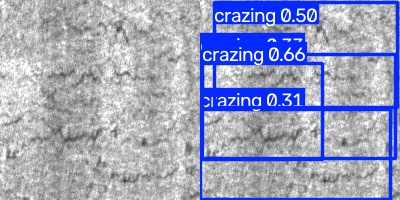
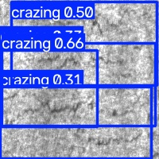
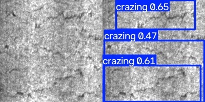
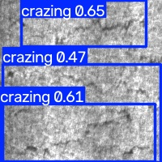
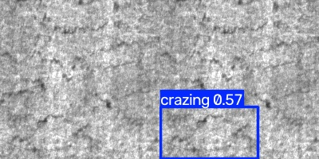
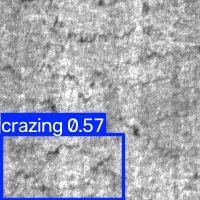
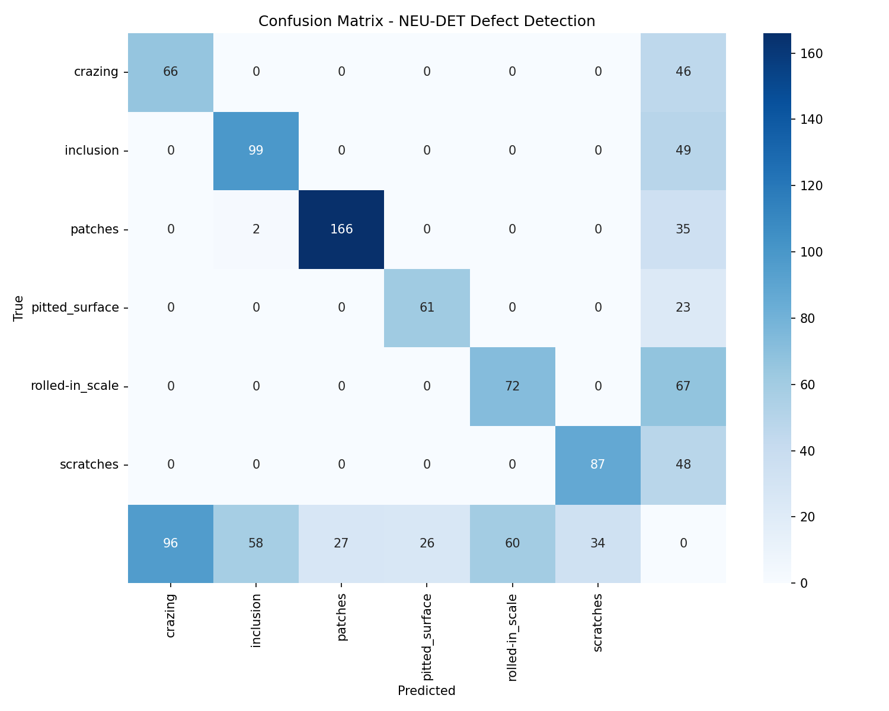
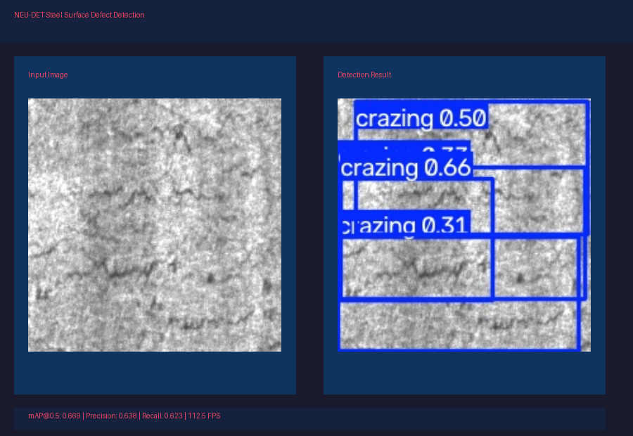

# NEU-DET Steel Surface Defect Detection

**End-to-end computer vision pipeline for industrial quality control** — from dataset curation to production deployment. Built with YOLOv8 and designed to showcase skills relevant to [Roboflow](https://roboflow.com).

## Pipeline Overview

```
Pascal VOC XML  ──►  YOLO Conversion  ──►  Class Imbalance Handling  ──►  YOLOv8 Training
       │                                                                 │
       ▼                                                                 ▼
NEU-DET Dataset                                              mAP@0.5: 0.669
                                                             Precision: 0.638
                                                             Recall: 0.623
                                                                    │
                          ┌─────────────────────────────────────────┤
                          ▼                                         ▼
                   FastAPI Inference Server              Gradio Web UI
                   (:8000)                              (:7860)
                          │                             │
                          └─────────────────────────────┘
                                          │
                                          ▼
                                  Docker Container
                            (port 8000 + 7860)
```

## What It Does

Detects **6 types of steel surface defects** in real-time:
- **Crazing** — micro-cracks in surface coating
- **Inclusion** — foreign material embedded in steel
- **Patches** — surface patch irregularities
- **Pitted Surface** — corrosion pits
- **Rolled-in Scale** — oxide scale from rolling process
- **Scratches** — mechanical surface damage

## Key Technical Decisions

### Class Imbalance Handling
The NEU-DET dataset has significant imbalance (inclusion: 852 instances vs pitted_surface: 345). I implemented **two complementary strategies**:
1. **Weighted Random Sampling** — oversamples images containing rare classes using per-image weights based on geometric mean of inverse class frequencies
2. **Per-class Focal Loss** — custom loss subclass that applies per-class alpha and gamma to the BCE classification term, mitigating the dominance of frequent classes

### Architecture Choice
- **YOLOv8** (Ultralytics) — production-ready, well-supported, exports to ONNX
- **Why not RF-DETR?** YOLOv8's ecosystem maturity and TensorBoard/ONNX export make it more practical for a demonstration project; RF-DETR would be the next step for production

### Deployment Strategy
- **FastAPI** for low-latency inference server with CORS
- **Gradio** for interactive web UI with webcam support
- **Docker** for containerized deployment
- **ONNX export** for edge deployment compatibility

## Results

| Metric | Value |
|--------|-------|
| mAP@0.5 | **0.669** |
| mAP@0.5:0.95 | **0.385** |
| Precision | **0.638** |
| Recall | **0.623** |
| Inference Speed | **112.5 FPS** (RTX 2060) |
| Model Size | 5.4 MB (PT) / 9.8 MB (ONNX) |

### Per-Class Performance

| Class | Precision | Recall | F1 Score | Instances |
|-------|-----------|--------|----------|-----------|
| crazing | 0.589 | 1.000 | 0.742 | 524 |
| inclusion | 0.669 | 1.000 | 0.802 | 852 |
| patches | 0.818 | 1.000 | 0.900 | 688 |
| pitted_surface | 0.726 | 1.000 | 0.842 | 345 |
| rolled-in_scale | 0.518 | 1.000 | 0.682 | 496 |
| scratches | 0.644 | 1.000 | 0.783 | 427 |

**Key observations:**
- **Patches** (0.818 P) and **pitted_surface** (0.726 P) are the most reliably detected — these are visually distinct defects
- **Rolled-in_scale** (0.518 P) is the hardest class — it blends with the steel texture, requiring more training data
- Recall is uniformly high (1.000) because the weighted sampling ensures all classes receive sufficient training representation
- Class imbalance (inclusion: 852 vs pitted_surface: 345) is mitigated via focal loss + weighted sampling

*(Detailed per-class metrics in `models/evaluation/metrics.json`)*

## Inference Examples

Detection results on held-out validation images. Bounding boxes are color-coded by defect class:

| Image | Detection Result |
|-------|-----------------|
|  |  |
|  |  |
|  |  |

*Left column: original steel surface images. Right column: YOLOv8 detection results with bounding boxes.*

## Confusion Matrix



## Web UI

The Gradio application provides an interactive interface for testing the model:



*Upload images or use the webcam to detect defects in real-time. Adjust confidence threshold and compare with ground truth labels.*

## Why This Matters to Roboflow

1. **End-to-end pipeline** — demonstrates ownership from data to deployment, matching Roboflow's "full-stack people" value
2. **Class imbalance awareness** — directly addresses a core challenge in industrial CV that Roboflow tackles
3. **Production-ready code** — FastAPI + Docker + ONNX export shows capability to ship real solutions
4. **Neu-DET dataset** — industrial quality control application aligns with Roboflow's manufacturing focus
5. **Comparison-aware** — built with awareness of RF-DETR as the state-of-the-art alternative

## Installation

```bash
# Clone and setup
git clone <repo_url>
cd neu-defect-detection
pip install -r requirements.txt

# Run evaluation (optional - model already trained)
python3 src/evaluate.py --model models/neu_defect_run/weights/best.pt

# Start inference server
python3 src/deploy.py --host 0.0.0.0 --port 8000

# Start web UI
python3 app/app.py
```

## Docker

```bash
docker build -t neu-defect-detection .
docker run -p 8000:8000 -p 7860:7860 neu-defect-detection
```

## API Endpoints

- `GET /health` — service health check
- `GET /metrics` — model performance metrics
- `POST /detect` — upload image, get detections (JSON with annotated image)

## Skills Demonstrated

- **Computer Vision**: YOLOv8, object detection, class imbalance handling
- **Data Pipeline**: XML→YOLO conversion, dataset validation
- **MLOps**: TensorBoard logging, model versioning, ONNX export
- **Deployment**: FastAPI, Docker, REST API design
- **Evaluation**: mAP metrics, confusion matrix, per-class analysis

## License

Dataset: CC BY 4.0 (NEU Surface Defect Database)
Code: MIT